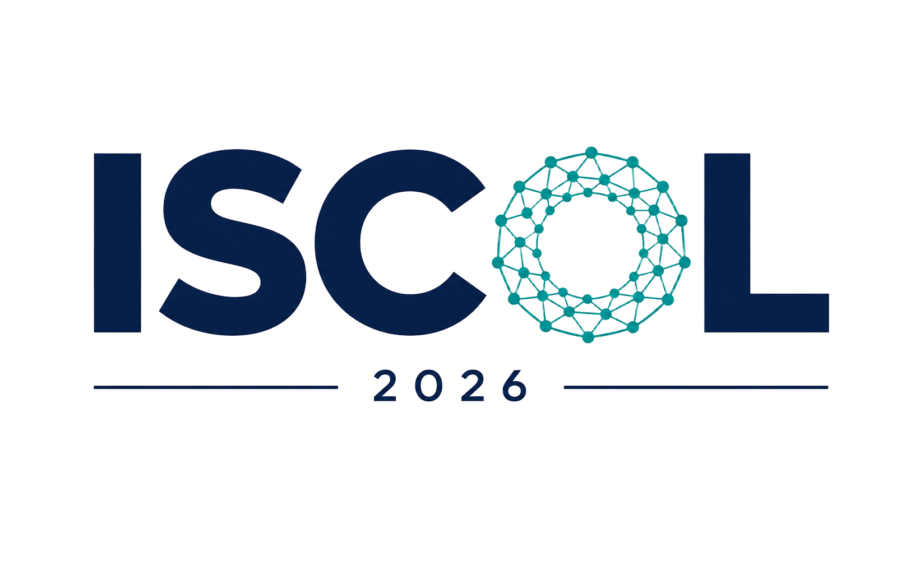

Hi, I'm Shachar.

I’m a Ph.D. candidate specializing in Natural Language Processing (NLP) at the Hebrew University of Jerusalem, under the supervision of [Omri Abend](https://www.cs.huji.ac.il/~oabend/). 

My research explores dialogue and interaction between humans and language models, as well as multi-model interactions. 
Drawing motivation and methodologies from cognitive science literature on human-human communication, such as dialogue alignment and reference games, I investigate the dynamics of human-AI interaction. Specifically, I study how users adapt to models over iterative interactions and how models can learn from the spontaneous, implicit feedback cues that humans naturally embed in conversation. Complementing this work on learning from conversational feedback, I also investigate LLM-as-a-Judge methodologies for automated model evaluation. 

In addition, I am a research intern at IBM Research, working on collaboratively pretraining by recycling finetuned models and evaluation.

 
 

### Join us at ISCOL 2026 🎉!

I'm co-organizing [ISCOL 2026](https://iscol-meeting.github.io/iscol2026/), the Israel Seminar on Computational Linguistics. It will be held on **December 23, 2026** at the Hebrew University of Jerusalem. Come share your work, meet the Israeli NLP community, and say hi!

 

### Check out ShareLM 💬!

The [ShareLM](https://sharelm.github.io/) plugin is a Chrome extension that makes it easy for you to contribute your own human-model interactions.

The Goal -> Collecting an ever-growing dataset of conversations, for the benefit of the open-source community 💬🥳

 

